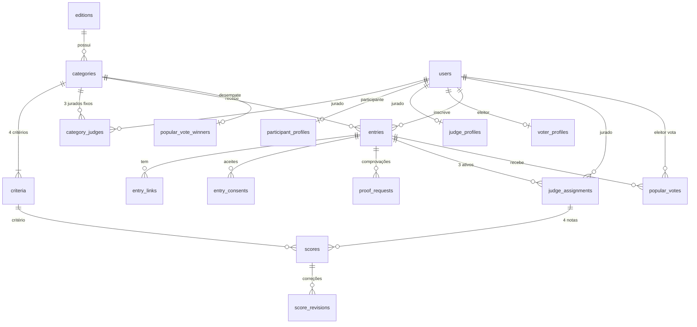
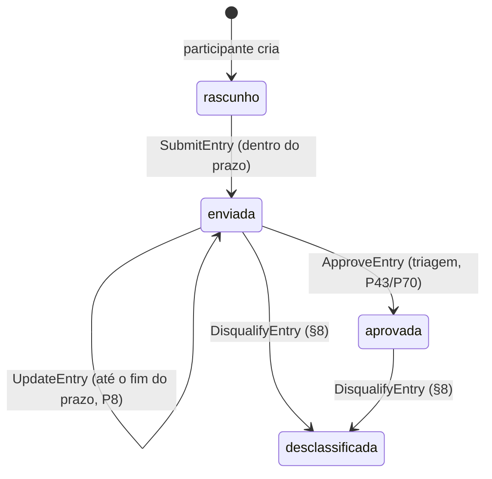

# 04 — Modelo de dados

**Banco:** o cPanel informou Percona Server 5.7.44-48/InnoDB (P65), validado localmente
com a imagem oficial `percona:5.7.44`. MySQL 8.0.46 também tem histórico de validação;
MariaDB não foi validado para esta release.

**Convenção:**
- **(§x)**: regra do edital.
- **(P#)**: decisão confirmada pelo responsável.
- **Recomendação**: escolha técnica (nomes de tabela, tipos, índices).
- **⚠️ P#**: pergunta em aberto.

**Convenções técnicas (Recomendação):**
- Nomes de tabelas e colunas em inglês, seguindo o padrão do Laravel.
- Valores de enum em português, porque aparecem no admin.
- Todas as tabelas têm `id` (bigint unsigned, auto incremento) e `created_at`/`updated_at`, salvo indicação contrária.
- Fuso da aplicação: `America/Fortaleza` (`config/app.php`).
- Os enums do banco são espelhados em **Enums PHP** (`app/Enums`).

---

## 1. Diagrama



---

## 2. Configuração e catálogo

### `editions`
Tem **um único registro**, porque o sistema atende só 2026 (P32). A tabela existe para que as datas sejam **editáveis no admin**, já que o edital permite alterações (§7).

| Coluna | Tipo | Nulo | Valor inicial / origem |
|---|---|---|---|
| name | varchar(255) | não | "1º Prêmio Ceará Tem Design 2026" (§1) |
| year | smallint unsigned | não | 2026 |
| registration_starts_at | datetime | não | 28/09/2026 00:00 (§7) |
| registration_ends_at | datetime | não | 28/10/2026 23:59:59, horário de Fortaleza (§7, P77) |
| judging_starts_at / judging_ends_at | datetime | não | 29/10 → 20/11/2026 (§7) |
| voting_starts_at / voting_ends_at | datetime | não | 29/10 → 20/11/2026 (P38). Em colunas próprias, porque as datas podem mudar (§7) |
| results_announce_on | date | não | 21/11/2026 (§7). Informativo: a publicação é manual (P69) |
| ceremony_on | date | não | 26/11/2026 (§7). Informativo |
| project_period_starts_on / ends_on | date | não | 01/01/2022 → 28/10/2026 (§2) |
| judges_per_entry | tinyint unsigned | não | 3 (§5) |
| band_gold_min / band_silver_min / band_bronze_min / band_honorable_min | tinyint unsigned | não | 54 / 48 / 42 / 36 (§6) |
| results_published_at | datetime | sim | Preenchido pelo botão **Publicar resultado** (P69) |

> **Convenção técnica aplicada na SPEC-001 (não é regra adicional do edital):** os seis campos datetime dos períodos de inscrição, avaliação e votação usam o fuso `America/Fortaleza`; cada início fica às 00:00:00 e cada término às 23:59:59 da data configurada. O término das inscrições em 28/10 às 23:59:59 também corresponde a P77. Datas informativas e de elegibilidade continuam em colunas `date`, sem horário.

### `categories`
| Coluna | Tipo | Nulo | Observação |
|---|---|---|---|
| edition_id | FK → editions | não | |
| code | varchar(4) | não | "3.1" … "3.9" (§3) · **único** |
| name | varchar(255) | não | (§3) |
| slug | varchar(255) | não | **único** (URL da galeria) |
| description | text | não | Texto do §3 |
| is_student_only | boolean | não | `true` só na 3.7 (P9) |
| sort | tinyint unsigned | não | Ordem de exibição |

Imagem de cada categoria no site: ⚠️ depende do conteúdo (P27).

### `criteria`
| Coluna | Tipo | Nulo | Observação |
|---|---|---|---|
| category_id | FK → categories | não | |
| name | varchar(255) | não | (§5) |
| description | varchar(500) | sim | (§5) |
| sort | tinyint unsigned | não | 1–4 |

- **Único:** `(category_id, sort)`.
- **Seed:**
  - categorias 3.1–3.8: Conceito e criatividade · Qualidade do projeto · Adequação · Relevância;
  - categoria 3.9: Design e diferenciação · Qualidade do produto · Potencial de mercado · Potencial de internacionalização (§5).

---

## 3. Usuários e perfis

Todos os usuários ficam em `users`, com o papel em uma coluna `role` (T2). Os dados específicos de cada papel ficam em **tabelas de perfil 1:1** (Recomendação). O motivo: o CPF do eleitor precisa ser único **entre eleitores** (P35), mas a mesma pessoa pode ter uma conta de participante PF com o mesmo CPF e um cadastro de eleitor separado (P60, T4). Uma coluna `cpf` única em `users` bloquearia isso.

### `users`
| Coluna | Tipo | Nulo | Observação |
|---|---|---|---|
| name | varchar(255) | não | |
| email | varchar(255) | não | **único**. Quem já tem outra conta usa outro e-mail para votar (T4) |
| password | varchar(255) | não | hash (padrão Laravel) |
| role | enum(`admin`,`jurado`,`participante`,`eleitor`) | não | (T2) |
| email_verified_at | datetime | sim | Não é exigido do participante (P73) nem do eleitor (P42) |
| remember_token | varchar(100) | sim | padrão Laravel |

### `participant_profiles`
| Coluna | Tipo | Nulo | Observação |
|---|---|---|---|
| user_id | FK → users | não | **único** |
| person_type | enum(`pf`,`pj`) | não | (P3) |
| document | varchar(14) | não | CPF (11 dígitos) ou CNPJ (14 caracteres: numérico ou alfanumérico, P81), sem máscara, validado pelo dígito verificador (P4). **único** (P74) |
| phone | varchar(20) | não | telefone/WhatsApp (P4) |
| city | varchar(120) | não | (P4) |
| state | char(2) | não | UF (P4) |
| participant_type | enum(`profissional`,`escritorio_estudio_equipe_coletivo`,`estudante`,`empresa`,`instituicao`,`osc`) | não | Lista do §2 (P4) |

### `judge_profiles`
| Coluna | Tipo | Nulo | Observação |
|---|---|---|---|
| user_id | FK → users | não | **único** |
| bio | text | não | Mini bio pública (P59) |
| foto | — | — | Media Library, coleção `photo` (P59) |

A conta do jurado é criada pelo admin, com senha (P17).

### `voter_profiles`
| Coluna | Tipo | Nulo | Observação |
|---|---|---|---|
| user_id | FK → users | não | **único** |
| cpf_hash | char(64) | não | **único**. HMAC-SHA256 do CPF normalizado: garante 1 CPF por eleitor (P35) sem guardar o CPF em claro (Recomendação, LGPD) |
| cpf_encrypted | text | não | CPF criptografado com a chave da aplicação (cast `encrypted` do Laravel), para consulta pela organização se precisar (Recomendação) |
| registration_ip | varchar(45) | não | IPv4 ou IPv6. Usado no limite por IP (P52) |

Validação do CPF: só o dígito verificador (P42), com Turnstile e limite de 5 cadastros por IP por hora (P50, P52). O limite é aplicado pelo RateLimiter do Laravel, então não precisa de tabela própria.

### `category_judges`
| Coluna | Tipo | Observação |
|---|---|---|
| category_id | FK → categories | |
| user_id | FK → users (role jurado) | |

- **Único:** `(category_id, user_id)`.
- Regra na aplicação: **no máximo 3 por categoria** (P14).

---

## 4. Inscrições

### `entries`
| Coluna | Tipo | Nulo | Origem |
|---|---|---|---|
| edition_id | FK → editions | não | |
| category_id | FK → categories | não | §4 |
| user_id | FK → users (participante) | não | §4 |
| title | varchar(255) | sim* | nome do projeto (§4) |
| authorship_credits | text | sim* | autoria e principais créditos (§4) |
| summary | text | sim* | breve apresentação (§4) |
| context_solution | text | sim* | contexto e solução desenvolvida (§4) |
| results_differentials | text | sim* | principais resultados ou diferenciais (§4) |
| ai_used | boolean | sim* | uso relevante de IA generativa (§8) |
| ai_usage_description | text | sim | Obrigatório se `ai_used = true` (§8) |
| status | enum(`rascunho`,`enviada`,`aprovada`,`desclassificada`) | não | ver seção 4.1 |
| submitted_at | datetime | sim | primeiro envio |
| approved_at / approved_by | datetime / FK users | sim | triagem (P43, P70) |
| disqualified_at / disqualified_by | datetime / FK users | sim | (§8) |
| disqualification_reason | text | sim | (§8) |
| final_score | tinyint unsigned | sim | 12–60, calculado (§5) |
| distinction | enum(`ouro`,`prata`,`bronze`,`mencao_honrosa`,`sem_distincao`) | sim | calculada (§6) |

\* Pode ficar nulo enquanto for **rascunho**. Todos os campos marcados com \* são **obrigatórios para enviar** (§4). Limite técnico de **5.000 caracteres** por texto (P75).

**Índices e regras:**
- **Único `(edition_id, category_id, user_id)`**: 1 projeto por categoria (§4).
- Categoria com `is_student_only` só aceita `participant_type = estudante`, e o estudante só pode se inscrever em categoria `is_student_only` (P9). Essa regra fica na aplicação.
- O mesmo projeto pode ir para mais de uma categoria, sem bloqueio (P10). Cada inscrição é independente.

**Arquivos (Media Library, tabela `media`):**

| Coleção | Regras |
|---|---|
| `images` | De 1 a 10 imagens (§4, P6), JPG, PNG ou WebP, até 5 MB cada (P6). Disco privado até a galeria (P55) |
| `supplementary_pdf` | PDF complementar (P7): opcional, 1 arquivo, até 10 MB (P45). Disco privado |

### 4.1 Status da inscrição



- **rascunho** (Recomendação): permite salvar antes de enviar. Um rascunho não enviado até o fim do prazo não é avaliado.
- **enviada**: editável até o fim do prazo (P8).
- **aprovada**: **não pode mais ser editada** (P70), entra na **galeria e na votação popular** (P37, P43, P55) e vai para os **jurados** (P76).
- **desclassificada**: sai de tudo (§8).
- A comprovação **não muda o status** da inscrição. Um projeto aprovado com comprovação pendente continua na galeria, na votação e na avaliação (P72). Ver `proof_requests`.

### `entry_links`
| Coluna | Tipo | Observação |
|---|---|---|
| entry_id | FK → entries | |
| url | varchar(2048) | validada como URL (P7) |
| label | varchar(255), nulo | descrição opcional |
| sort | tinyint unsigned | |

Limite técnico de **5 links** por inscrição (P75).

### `entry_consents`
Um registro por aceite, com data/hora e IP (P11, P53).

| Coluna | Tipo | Observação |
|---|---|---|
| entry_id | FK → entries | |
| consent | enum(`veracidade`,`autorizacao_inscricao`,`creditos`,`uso_imagens_materiais`,`regras_edital`,`autorizacao_divulgacao`) | os 5 itens de "Ao realizar a inscrição…" + a autorização de uso para divulgação (§8) |
| accepted_at | datetime | |
| ip | varchar(45) | |
| created_at | datetime | sem `updated_at`: o registro nunca é alterado |

Recomendação: gravar um conjunto novo de aceites **a cada envio ou edição**, mantendo o histórico.

### `proof_requests` (comprovação, P12)
| Coluna | Tipo | Nulo | Observação |
|---|---|---|---|
| entry_id | FK → entries | não | |
| requested_by | FK → users (admin) | não | |
| message | text | não | o que a organização está pedindo |
| deadline_at | datetime | não | prazo definido pelo admin (P56) |
| status | enum(`pendente`,`respondida`,`aceita`,`recusada`) | não | `aceita`/`recusada` = análise da organização (Recomendação). O que acontece depois fica a critério da organização (P56) |
| responded_at | datetime | sim | |
| is_late | boolean | não | `true` se enviada depois de `deadline_at`. O envio atrasado é aceito, e a organização decide (P79) |
| reviewed_at / reviewed_by | datetime / FK users | sim | |

Arquivo: Media Library, coleção `proof`, com **1 PDF de até 10 MB** (P54).

---

## 5. Avaliação dos jurados

### `judge_assignments`
| Coluna | Tipo | Nulo | Observação |
|---|---|---|---|
| entry_id | FK → entries | não | só inscrições **aprovadas** (P76) |
| judge_id | FK → users (jurado) | não | |
| status | enum(`pendente`,`enviada`,`substituida`) | não | |
| submitted_at | datetime | sim | depois do envio, as notas **travam** (P19) |
| replaced_at / replaced_by | datetime / FK users (admin) | sim | substituição por conflito (§8, P16) |
| replacement_reason | text | sim | obrigatório ao substituir (Recomendação) |
| assigned_by | FK → users (admin) | não | atribuição manual (P15) |

**Regras:**
- **Único:** `(entry_id, judge_id)`.
- Cada inscrição aprovada tem exatamente `editions.judges_per_entry` (3) atribuições **não substituídas** (§5).
- Por padrão, são os 3 jurados fixos da categoria (P14).
- Em caso de conflito, a organização marca a atribuição como `substituida` e cria outra com **qualquer jurado** escolhido por ela (P16, P47).
- Uma atribuição `substituida` que já tinha notas: as notas são mantidas para histórico, mas **não entram** no cálculo.

### `scores`
| Coluna | Tipo | Observação |
|---|---|---|
| judge_assignment_id | FK → judge_assignments | |
| criterion_id | FK → criteria | deve ser da categoria da inscrição (regra na aplicação) |
| value | tinyint unsigned | **1 a 5** (§5) |

- **Único:** `(judge_assignment_id, criterion_id)`.
- `CHECK (value BETWEEN 1 AND 5)`: só é criado no MySQL 8.0.16 ou superior. No Percona
  5.7.44-48 a migration o omite deliberadamente; `SaveScores` e `CorrectScore` garantem
  inteiros de 1 a 5, cobertos por testes executados nesse banco. A regra de negócio não
  depende do `CHECK`.
- O jurado não deixa comentário (P18).

### `score_revisions` (correção pela organização, P19, P46)
| Coluna | Tipo | Observação |
|---|---|---|
| score_id | FK → scores | |
| old_value / new_value | tinyint unsigned | |
| reason | text, **não nulo** | justificativa obrigatória (P46) |
| changed_by | FK → users (admin) | |
| created_at | datetime | sem `updated_at` |

---

## 6. Voto popular

### `popular_votes`
| Coluna | Tipo | Observação |
|---|---|---|
| voter_id | FK → users (eleitor) | |
| entry_id | FK → entries | só inscrições **aprovadas** (P37) |
| category_id | FK → categories | cópia da categoria da inscrição, usada no índice único |
| ip | varchar(45) | |
| created_at | datetime | sem `updated_at`: o voto é final (P71) |

**Regras:**
- **Único `(voter_id, category_id)`**: 1 voto por categoria (P36).
- Só é aceito dentro do período `voting_starts_at`–`voting_ends_at` (P38).
- Qualquer CPF vota, inclusive participantes e jurados com cadastro de eleitor separado, e até no próprio projeto (P58, P60).
- A contagem fica oculta para o público até a publicação (P39). O admin vê a parcial (P48).
- Votos em projeto **desclassificado** ficam no banco, mas **não contam** na apuração. O eleitor **não vota de novo** naquela categoria (P78).

### `popular_vote_winners`
Registra o mais votado de cada categoria (P40) e a **decisão da organização em caso de empate** (P49). Recomendação.

| Coluna | Tipo | Observação |
|---|---|---|
| category_id | FK → categories | **único** |
| entry_id | FK → entries | |
| votes | int unsigned | total no momento da apuração |
| was_tie | boolean | |
| decided_by | FK → users (admin), nulo | preenchido quando houve empate |
| decision_note | text, nulo | |

⚠️ Se o voto popular é um prêmio separado ou entra na nota: P34. Hoje o modelo trata como **resultado separado**, sem alterar `final_score`.

---

## 7. Conteúdo do site

| Tabela | Colunas | Origem |
|---|---|---|
| `partners` | name, url (nulo), logo (media), sort | Seção Parceiros (P26) |
| `board_members` | name, role_title, photo (media), sort | Seção Diretoria (P26) |

Textos das seções (Hero, Sobre, Como participar): ⚠️ o conteúdo depende de P27. Recomendação: começar com textos fixos em Blade, tirados do edital.

---

## 8. Tabelas de infraestrutura (padrão Laravel)

- `sessions`, `cache`, `cache_locks`, `jobs`, `job_batches`, `failed_jobs`: drivers `database`, já que a hospedagem compartilhada não tem Redis garantido (ver 02-stack).
- `password_reset_tokens`: recuperação de senha (Fortify, T1).
- `media`: Spatie Media Library.
- `activity_log`: Spatie Activitylog, para mudanças de status, atribuições e publicação (Recomendação).

---

## 9. Cálculo do resultado (§5, §6)

```
atribuições válidas = judge_assignments da inscrição com status "enviada"
                      (as "substituida" ficam de fora)

se atribuições válidas < judges_per_entry (3) → sem resultado (avaliação incompleta)

final_score = soma de todas as notas das 3 atribuições válidas   (12 a 60)

final_score >= 54 → ouro
final_score >= 48 → prata
final_score >= 42 → bronze
final_score >= 36 → mencao_honrosa
senão             → sem_distincao
```

As faixas vêm de `editions.band_*` (§6).

**Testes obrigatórios (Recomendação):** fronteiras 60, 54, 53, 48, 47, 42, 41, 36, 35 e 12. Também avaliação incompleta, atribuição substituída e nota corrigida (`score_revisions`).
